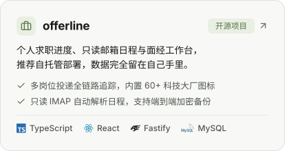
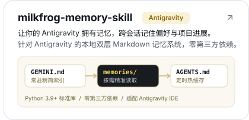
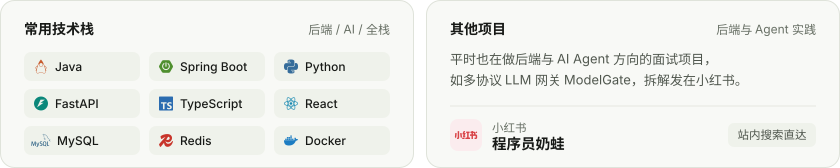

  <picture>
    <source media="(prefers-color-scheme: dark)" srcset="./assets/hero-dark.svg" />
    <source media="(prefers-color-scheme: light)" srcset="./assets/hero-light.svg" />
    
  </picture>

  <a href="https://github.com/milkfrogdev/offerline"><picture><source media="(prefers-color-scheme: dark)" srcset="./assets/card-offerline-dark.svg" /><source media="(prefers-color-scheme: light)" srcset="./assets/card-offerline-light.svg" /></picture></a><a href="https://github.com/milkfrogdev/milkfrog-memory-skill"><picture><source media="(prefers-color-scheme: dark)" srcset="./assets/card-memory-dark.svg" /><source media="(prefers-color-scheme: light)" srcset="./assets/card-memory-light.svg" /></picture></a>

  <picture>
    <source media="(prefers-color-scheme: dark)" srcset="./assets/bottom-dark.svg" />
    <source media="(prefers-color-scheme: light)" srcset="./assets/bottom-light.svg" />
    
  </picture>

